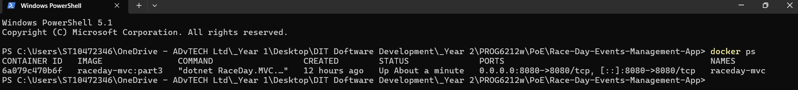
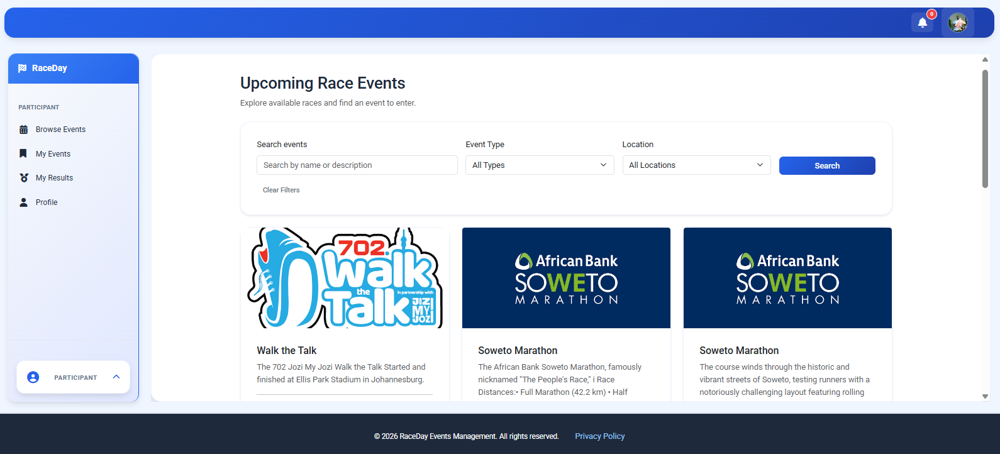
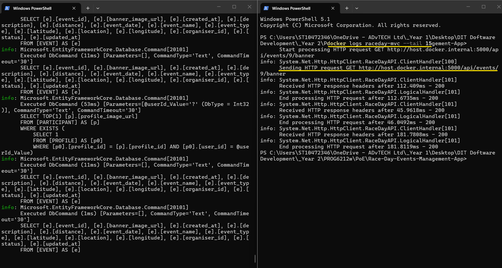
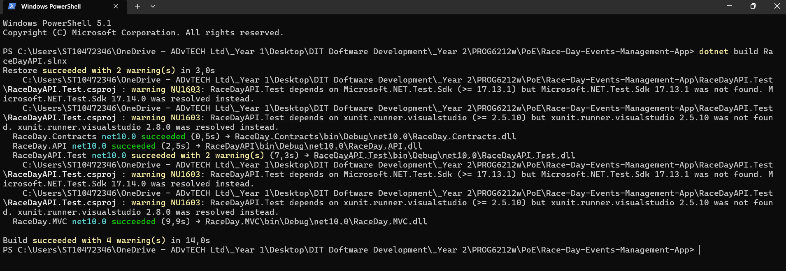
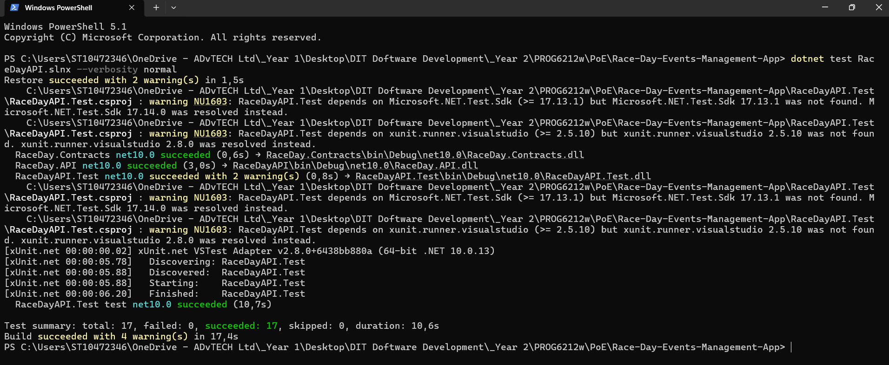
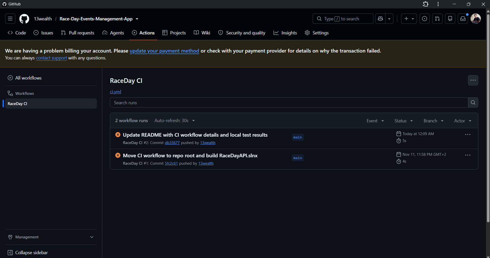

# RaceDay Events Management App

## Overview

RaceDay is an Events Management application designed to manage race events, organisers, participants, event categories, enrolments and race results.

The project is delivered in three parts:

1. **Documentation and database design**: SQL Server database script, API endpoint documentation and an Entity Relationship Diagram (ERD).
2. **REST API**: an ASP.NET Core Web API (.NET 10) with authentication, role-based authorisation and unit tests.
3. **MVC web application**: an ASP.NET Core MVC front end that consumes the API, with Azure Blob Storage support in the API and a Docker container for the MVC app.

Illustration video: [▶️ RaceDay illustration video](https://youtu.be/mhHBowUxImE)

## Architecture

```plaintext
Browser  →  RaceDay.MVC  →  RaceDayAPI  →  SQL Server
                                   └─────→  Azure Blob Storage
```

- `RaceDay.MVC` does not access the database directly. All data comes from the API over HTTP, using the address set in `ApiSettings:BaseUrl`.
- `RaceDay.Contracts` holds the data transfer objects (DTOs) shared by the API and the MVC app.
- Azure Blob Storage is used by the API for image storage (container `raceday-images`).

## Repository Structure

```plaintext
ST10472346-RaceDay-Events-Management-App/
│
├── .github/
│   └── workflows/
│       └── ci.yml
│
├── docs/
│   ├── RaceDay.sql
│   ├── race_day_api_endpoints.pdf
│   └── race_day_erd.pdf
│
├── RaceDay.Contracts/        # Shared DTOs (auth, categories, enrolments, events, profiles, results)
│
├── RaceDayAPI/               # REST API project (RaceDay.API)
│   ├── Controllers/          # API endpoint controllers
│   ├── Data/                 # EF Core DbContext
│   ├── Migrations/           # EF Core migrations
│   ├── Models/               # Data entities and database models
│   ├── Security/             # Authentication and authorization
│   ├── Services/             # Business logic
│   ├── Storage/              # Storage integration
│   ├── appsettings.json      # Configuration
│   ├── Program.cs            # Application startup
│   └── RaceDay.API.csproj    # API project file
│
├── RaceDay.MVC/              # MVC web application
│   ├── Controllers/
│   ├── Models/
│   ├── Services/             # API client services
│   ├── ViewModels/
│   ├── Views/
│   ├── wwwroot/
│   ├── appsettings.json      # Contains ApiSettings:BaseUrl
│   ├── Dockerfile            # Container build instructions for the MVC app
│   ├── Program.cs
│   └── RaceDay.MVC.csproj
│
├── RaceDayAPI.Test/
│   ├── AuthControllerTests.cs
│   ├── EnrollmentControllerTests.cs
│   ├── EventControllerTests.cs
│   ├── RoleTests.cs
│   └── RaceDayAPI.Test.csproj
│
├── .dockerignore             # Files excluded from the Docker build context
├── RaceDayAPI.slnx           # Solution file
└── README.md
```

### Folder Description

| Folder/File                       | Description                                                                                    |
| --------------------------------- | ---------------------------------------------------------------------------------------------- |
| `.github/workflows/`              | Contains the GitHub Actions workflow (`ci.yml`) that builds the solution and runs the tests.   |
| `docs/RaceDay.sql`                | SQL Server database creation script and sample seed data.                                      |
| `docs/race_day_api_endpoints.pdf` | API endpoint documentation for the RaceDay application.                                        |
| `docs/race_day_erd.pdf`           | Entity Relationship Diagram showing the database structure.                                    |
| `RaceDay.Contracts/`              | Class library with the DTOs shared by the API and the MVC app.                                 |
| `RaceDayAPI/`                     | Main .NET 10 ASP.NET Core API project with controllers, models, and business logic.            |
| `RaceDay.MVC/`                    | .NET 10 ASP.NET Core MVC web application that consumes the API.                                |
| `RaceDayAPI.Test/`                | Unit tests for the API using the xUnit framework.                                              |
| `.dockerignore`                   | Keeps build output and other unneeded files out of the Docker build.                           |
| `RaceDayAPI.slnx`                 | Visual Studio solution containing all four projects.                                           |
| `README.md`                       | Project documentation and repository information.                                              |

## Database

The `RaceDay.sql` script creates the RaceDay SQL Server database and its related tables.

The database includes entities for:

* Users
* Organisers
* Participants
* Profiles
* Events
* Categories
* Routes
* Enrolments
* Results
* Performance History

The script also contains sample data for testing and demonstration purposes.

## API Implementation

The `RaceDayAPI` project provides a complete REST API implementation in .NET 10 with the following features:

### Key Features

- **Authentication**: User registration and login with session management
- **Authorization**: Role-based access control (Participant/Organizer roles)
- **User Management**: Create and manage user profiles with proper type safety (RaceDayUser model)
- **Password Security**: Hashing using ASP.NET Core Identity's PasswordHasher
- **Testing**: Comprehensive unit tests with xUnit framework

### Project Structure

- **Controllers**: API endpoints for authentication and event management
- **Models**: Entity definitions aligned with database schema
- **Data**: EF Core DbContext for database operations
- **Contracts**: Request/Response models (in the `RaceDay.Contracts` project)
- **Security**: Custom authorization attributes and authentication logic
- **Tests**: Unit tests ensuring reliability

## MVC Web Application

The `RaceDay.MVC` project is the web front end. It calls the API for all data, including login, events, enrolments and results. The API address is configured in `RaceDay.MVC/appsettings.json`:

```json
"ApiSettings": {
  "BaseUrl": "http://localhost:5093/"
}
```

## Prerequisites

- .NET 10 SDK
- SQL Server Express (the connection string is in `RaceDayAPI/appsettings.json`; update `DefaultConnection` to match your SQL Server instance)
- The database created with `docs/RaceDay.sql`
- Docker Desktop (only needed for the Docker steps below)

### Azure Blob Storage configuration

The API stores images in the Azure Blob Storage container `raceday-images`. Real Azure connection details are **never committed to GitHub**. Add them with .NET user secrets on the API project (see the `AzureBlobStorage` section of `RaceDayAPI/appsettings.json` for the setting names) or with environment variables.

## Building & Running

### Build and test

```bash
# Build the solution
dotnet build RaceDayAPI.slnx

# Run tests
dotnet test RaceDayAPI.slnx
```

### Run the API

```bash
dotnet run --project RaceDayAPI
```

By default the API listens on `http://localhost:5093` and `https://localhost:7054`.

### Run the MVC app locally

With the API running, in a second terminal:

```bash
dotnet run --project RaceDay.MVC
```

Open the URL printed in the console.

### Build Status

✅ **All tests passing**  
✅ **Solution builds successfully**  
✅ **Type safety verified** (RaceDayUser model properly configured)

## Running the MVC App with Docker

The MVC app runs in a Docker container. The API keeps running on the host machine, and the container reaches it through `host.docker.internal`. The API address is passed in with the `ApiSettings__BaseUrl` environment variable, so no code change or rebuild is needed to change it.

### Requirements

- Docker Desktop running with Linux containers (WSL 2 backend)
- The API running on the host machine on port 5000

### 1. Build the image

Run from the repository root (the folder containing `RaceDay.MVC`, `RaceDayAPI` and `RaceDay.Contracts`):

```bash
docker build -f RaceDay.MVC/Dockerfile -t raceday-mvc:part3 .
```

### 2. Start the API on the host

In a separate terminal, from the repository root:

```bash
dotnet run --project RaceDayAPI --urls http://0.0.0.0:5000
```

### 3. Run the MVC container

```bash
docker run -d --name raceday-mvc -p 8080:8080 -e ApiSettings__BaseUrl=http://host.docker.internal:5000/ raceday-mvc:part3
```

The container shows as running with `docker ps`:



### 4. Open the app

Browse to http://localhost:8080

The RaceDay MVC app running from the container and showing data from the API:



### Useful Docker commands

| Command                    | Purpose                                                             |
| -------------------------- | ------------------------------------------------------------------- |
| `docker ps`                | Show the running container                                          |
| `docker logs raceday-mvc`  | Show the container logs                                             |
| `docker stop raceday-mvc`  | Stop the container                                                  |
| `docker start raceday-mvc` | Start the stopped container again                                   |
| `docker rm raceday-mvc`    | Remove the container (required before running step 3 a second time) |

The container logs show the MVC app calling the API through `host.docker.internal:5000` and receiving `200` responses:



### Troubleshooting

- **Container name already in use**: run `docker rm -f raceday-mvc`, then run step 3 again.
- **Port 8080 already in use**: stop the other container or program using it, or map a different host port, for example `-p 8081:8080`.
- **Pages load but data fails**: check that the API is running on port 5000, then run `docker logs raceday-mvc`.
- **Old page shown in the browser**: clear the browser cache or use a private window.

## Testing & Validation Checklist

The following functionality has been tested and verified to be working correctly using Swagger document. 
Complete evidence of testing and results is documented in [docs/api-test-results-evidence.pdf](docs/api-test-results-evidence.pdf).

### Completed Checks

- ✅ **RaceDay.Api builds with no errors** - Project successfully compiles in .NET 10
- ✅ **SQL Server connection works** - Database connectivity verified and functional
- ✅ **Swagger opens** - API documentation endpoint accessible via Swagger UI
- ✅ **Registration works** - User registration endpoint tested and operational
- ✅ **Login works and creates the API session** - Authentication and session management verified
- ✅ **GET /api/events works** - Event retrieval endpoint functional
- ✅ **Organiser can create/update/delete an Event** - Event management operations verified for organiser role
- ✅ **Participant can enrol** - Enrollment functionality tested and working
- ✅ **Organiser can view enrolments** - Organiser access to enrollment data verified
- ✅ **Organiser can capture results** - Result recording functionality operational
- ✅ **Participant can view own results** - Result retrieval for participants verified
- ✅ **All Part 2 unit tests pass** - Comprehensive unit test suite passing successfully
- ✅ **MVC app builds as a Docker image and runs in a container** - Login and events pages work against the API through `host.docker.internal`

### Test Evidence

Detailed test results, screenshots, and validation evidence are available in:
📄 **[docs/api-test-results-evidence.pdf](docs/api-test-results-evidence.pdf)**

## GitHub Actions / CI

GitHub Actions builds the whole solution and runs the unit tests whenever changes are pushed to the repository or a pull request is created.

The workflow is `.github/workflows/ci.yml`. It:

1. Checks out the code.
2. Sets up the .NET 10 SDK.
3. Builds the solution with `dotnet build RaceDayAPI.slnx` (API, Contracts, MVC and test projects).
4. Runs the unit tests with `dotnet test RaceDayAPI.slnx`.

### Local verification

The same two commands were run locally on 12 November 2026:

* `dotnet build RaceDayAPI.slnx`: build succeeded.
* `dotnet test RaceDayAPI.slnx`: 17 tests, 17 passed, 0 failed, 0 skipped.





> **Note:** At the time of submission, GitHub Actions runs are blocked by a billing lock on the GitHub account ("The job was not started because your account is locked due to a billing issue"). This is an account issue on GitHub's side and not a problem with the workflow or the code.



### Earlier workflow run

The following screenshot shows an earlier successful run of the repository-structure check from Part 1:


## Project Demonstration

[▶️ Watch the RaceDay project demonstration on YouTube](https://youtu.be/sulZqaSXf58)

## Technologies

* .NET 10
* ASP.NET Core Web API
* ASP.NET Core MVC
* Entity Framework Core
* SQL Server
* Azure Blob Storage
* Docker
* xUnit (Testing)
* SQL
* Git
* GitHub
* GitHub Actions

## Project Documentation

All supporting project documentation is stored in the `/docs` folder.

## Author

**ST10472346**